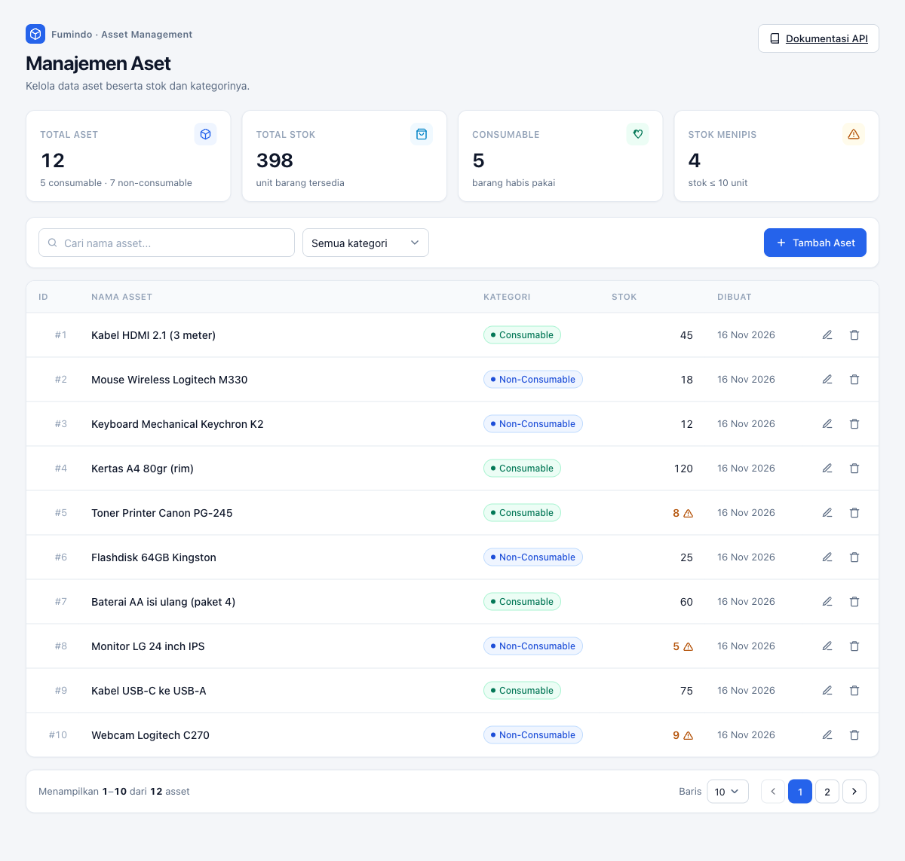
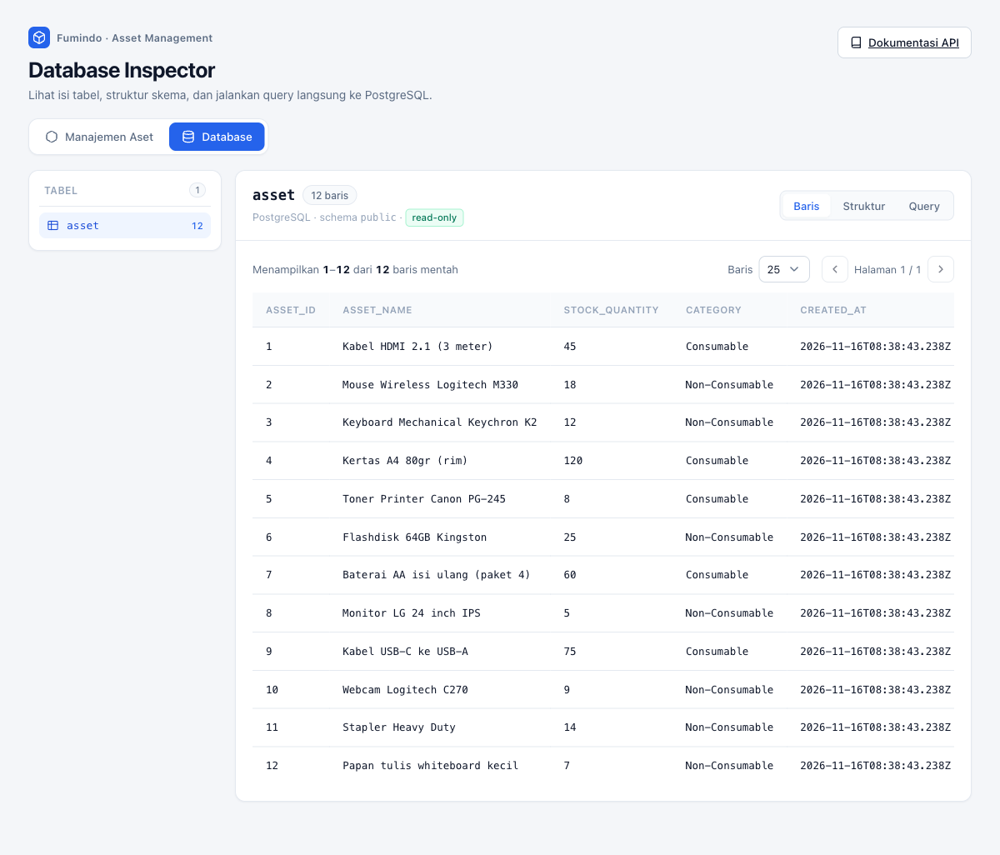

# Manajemen Aset &mdash; Soal Tes Internship Fumindo

Aplikasi CRUD management aset yang terdiri dari **database PostgreSQL**, **REST API NestJS**, dan
**halaman web Vue.js** yang terintegrasi satu sama lain.



## Bonus &mdash; Database Inspector

Selain memenuhi 3 requirement soal, aplikasi ini juga punya tab **Database** yang menampilkan
database PostgreSQL secara langsung: daftar tabel, isi baris mentah, struktur skema lengkap, dan
query runner SQL.



Endpoint barunya bersifat **read-only** dengan dua lapis proteksi:

1. **Filter di aplikasi** &mdash; hanya `SELECT` yang diterima, statement berbahaya dan query
   multi-statement ditolak.
2. **Transaksi `READ ONLY` di PostgreSQL** &mdash; pengaman utama. PostgreSQL sendiri yang
   menolak setiap percobaan penulisan data (termasuk *data-modifying CTE*), sehingga data tetap
   aman bahkan untuk query yang lolos filter.

---

## Daftar Isi

1. [Ringkasan Soal vs Implementasi](#ringkasan-soal-vs-implementasi)
2. [Tech Stack](#tech-stack)
3. [Struktur Proyek](#struktur-proyek)
4. [Cara Menjalankan](#cara-menjalankan)
5. [Desain Database](#desain-database)
6. [Dokumentasi API](#dokumentasi-api)
7. [Pengujian](#pengujian)
8. [Catatan Teknis](#catatan-teknis)

---

## Ringkasan Soal vs Implementasi

| # | Requirement Soal | Implementasi |
|---|---|---|
| 1 | Database PostgreSQL bernama `asset_fumindo` dengan tabel `asset` (field `asset_id`, `asset_name`, `stock_quantity`, `category` dengan nilai `Consumable` / `Non-Consumable`) | `db/schema.sql` &mdash; enum native PostgreSQL, constraint, index, trigger `updated_at`. Dibuat otomatis oleh `db/setup.sh`. |
| 2 | API NestJS untuk operasi CRUD pada tabel `asset` | `api/` &mdash; RESTful endpoint lengkap + filter, pagination, validasi, error handling, Swagger UI, health check, dan test otomatis. |
| 3 | Halaman web Vue.js untuk CRUD, terintegrasi dengan API NestJS | `web/` &mdash; Vue 3 + Vite + TypeScript, tabel dengan pencarian/filter/pagination, modal form, dialog konfirmasi hapus, toast, dan state loading/error/empty. |
| + | *(bonus)* Menampilkan isi database secara langsung di aplikasi | Tab **Database Inspector**: daftar tabel, baris mentah, struktur skema (kolom/constraint/index/enum), dan query runner SQL read-only. |

---

## Tech Stack

| Lapisan | Teknologi |
|---|---|
| Database | PostgreSQL 14+ (enum native, CHECK constraint, trigger, index) |
| Backend | NestJS 12 (ESM), TypeORM 1.x, `pg`, class-validator, Swagger |
| Frontend | Vue 3 (Composition API), Vite 8, TypeScript, CSS tulis tangan |
| Testing | Vitest (unit + e2e), Supertest |
| Tooling | TypeScript strict, oxlint, Prettier |

---

## Struktur Proyek

```
.
├── db/
│   ├── schema.sql            # CREATE DATABASE, enum, tabel, index, trigger
│   └── setup.sh              # buat role + database + terapkan skema (idempotent)
│
├── api/                      # Backend NestJS
│   ├── src/
│   │   ├── main.ts           # bootstrap: CORS, Swagger, prefix /api
│   │   ├── app.setup.ts      # konfigurasi global (dipakai main + test e2e)
│   │   ├── app.module.ts     # root module
│   │   ├── assets/
│   │   │   ├── assets.controller.ts
│   │   │   ├── assets.service.ts
│   │   │   ├── assets.service.spec.ts   # unit test
│   │   │   ├── dto/                     # DTO validasi + response
│   │   │   └── entities/                # entity TypeORM + enum kategori
│   │   ├── common/filters/   # normalisasi format error
│   │   ├── config/           # konfigurasi & validasi env
│   │   ├── database/         # Database Inspector (read-only) + script seed
│   │   └── health/           # GET /api/health
│   ├── test/                 # e2e test (Supertest)
│   └── .env.example
│
├── web/                      # Frontend Vue 3
│   ├── src/
│   │   ├── App.vue           # shell aplikasi + tab navigasi
│   │   ├── api/              # client fetch + endpoint asset & database
│   │   ├── components/       # tabel, modal form, dialog, toast, stats
│   │   ├── components/database/  # panel database inspector
│   │   ├── composables/      # useAssets, useToast
│   │   ├── types/            # tipe asset & database
│   │   ├── views/            # AssetManagerView, DatabaseView
│   │   └── style.css         # design tokens + komponen dasar
│   └── vite.config.ts        # proxy /api -> backend
│
└── docs/                     # screenshot untuk dokumentasi
```

---

## Cara Menjalankan

### Prasyarat

- **Node.js** 20.11+ (diuji di v24)
- **PostgreSQL** 14+ yang sedang berjalan di `127.0.0.1:5432`
- **npm** 10+

### 1. Siapkan database

```bash
./db/setup.sh --with-test
```

Perintah ini akan membuat role `fumindo`, database `asset_fumindo` (+ `asset_fumindo_test` untuk
e2e test), lalu menerapkan skema dari `db/schema.sql`. Aman dijalankan berulang kali.

> Skrip mendeteksi user superuser otomatis. Di Homebrew PostgreSQL, user OS Anda adalah superuser
> (role `postgres` biasa tidak memiliki hak `CREATEROLE`). Override manual bila perlu:
> `PG_SUPERUSER=postgres ./db/setup.sh`.

### 2. Jalankan backend

```bash
cd api
npm install
cp .env.example .env        # sesuaikan bila konfigurasi DB Anda berbeda
npm run db:seed             # opsional: isi 12 data contoh
npm run start:dev
```

Backend berjalan di **http://localhost:3001** &mdash; Swagger UI di **http://localhost:3001/api/docs**.

### 3. Jalankan frontend

```bash
cd web
npm install
npm run dev
```

Buka **http://localhost:5173**. Vite memproxy request `/api` ke backend, sehingga tidak ada
masalah CORS selama development.

### Ringkasan Perintah

| Perintah | Fungsi |
|---|---|
| `npm run start:dev` | Jalankan API dengan watch mode |
| `npm run build` / `npm run start:prod` | Build & jalankan versi produksi |
| `npm run db:setup` | Buat database + skema |
| `npm run db:seed` | Isi data contoh (dilewati bila tabel sudah berisi data) |
| `npm run db:reset` | Reset isi tabel asset lalu seed ulang |
| `npm test` | Unit test (Vitest) |
| `npm run test:e2e` | E2E test (Supertest) |
| `npm run lint` | Lint dengan oxlint |

---

## Desain Database

### ERD

```
┌──────────────────────────┐
│        asset             │
├──────────────────────────┤
│ asset_id      PK, SERIAL │◄──── id sumber data
│ asset_name    VARCHAR(150)│      NOT NULL
│ stock_quantity INTEGER   │      NOT NULL, CHECK (>= 0)
│ category      ENUM       │      NOT NULL
│ created_at    TIMESTAMPTZ │      NOT NULL, default NOW()
│ updated_at    TIMESTAMPTZ │      NOT NULL, default NOW()
└──────────────────────────┘

ENUM asset_category
  ├── 'Consumable'
  └── 'Non-Consumable'
```

### Keputusan desain

- **`category` memakai enum native PostgreSQL**, bukan `VARCHAR` dengan `CHECK`. Nilai yang valid
  dijamin database, sehingga data yang masuk lewat SQL manual maupun aplikasi tetap konsisten.
- **`CHECK (stock_quantity >= 0)`** mencegah stok negatif di level database.
- **Trigger `updated_at`** mengisi kolom timestamp otomatis saat baris di-update, tanpa perlu
  newestration di kode aplikasi.
- **Index** pada `category` dan `asset_name` mendukung query filter dan pencarian.
- **`synchronize: false` pada TypeORM.** Skema dikelola sepenuhnya oleh `db/schema.sql` sebagai
  *source of truth*, sehingga tidak ada risiko TypeORM mengubah atau menghapus kolom saat
  aplikasi berjalan.

---

## Dokumentasi API

Base URL: `http://localhost:3001/api`

| Method | Endpoint | Deskripsi | Response |
|---|---|---|---|
| `GET` | `/assets` | List asset. Query: `search`, `category`, `page`, `limit` | `200` &mdash; `{ data, meta }` |
| `GET` | `/assets/stats` | Ringkasan agregat untuk dashboard | `200` |
| `GET` | `/assets/:id` | Detail satu asset | `200` / `404` |
| `POST` | `/assets` | Tambah asset baru | `201` |
| `PATCH` | `/assets/:id` | Perbarui asset (field opsional) | `200` / `404` |
| `DELETE` | `/assets/:id` | Hapus asset | `204` / `404` |
| `GET` | `/health` | Health check aplikasi + database | `200` |
| `GET` | `/database/tables` | Daftar tabel pada schema `public` + jumlah baris | `200` |
| `GET` | `/database/tables/:table/schema` | Struktur tabel: kolom, constraint, index, enum | `200` / `404` |
| `GET` | `/database/tables/:table/rows` | Baris mentah sebuah tabel | `200` / `404` |
| `POST` | `/database/query` | Jalankan query `SELECT` (read-only, maks. 500 baris) | `201` / `400` |

### Contoh

```bash
# List dengan filter & pagination
curl "http://localhost:3001/api/assets?search=kabel&category=Consumable&page=1&limit=10"

# Tambah asset
curl -X POST http://localhost:3001/api/assets \
  -H 'Content-Type: application/json' \
  -d '{"asset_name":"Kabel HDMI 2.1","stock_quantity":45,"category":"Consumable"}'

# Update
curl -X PATCH http://localhost:3001/api/assets/1 \
  -H 'Content-Type: application/json' \
  -d '{"stock_quantity":50}'

# Hapus
curl -X DELETE http://localhost:3001/api/assets/1
```

### Format response list

```json
{
  "data": [
    {
      "asset_id": 1,
      "asset_name": "Kabel HDMI 2.1 (3 meter)",
      "stock_quantity": 45,
      "category": "Consumable",
      "created_at": "2026-11-16T08:38:43.238Z",
      "updated_at": "2026-11-16T08:38:43.238Z"
    }
  ],
  "meta": { "total": 12, "page": 1, "limit": 10, "total_pages": 2 }
}
```

### Format error

Semua error (validasi, tidak ditemukan, internal) memakai satu format yang konsisten:

```json
{
  "statusCode": 400,
  "message": [
    "asset_name should not be empty",
    "stock_quantity must not be less than 0",
    "category must be one of the following values: Consumable, Non-Consumable"
  ],
  "error": "Bad Request",
  "path": "/api/assets",
  "timestamp": "2026-11-16T08:39:36.834Z"
}
```

Untuk error `500`, pesan internal **tidak dibocorkan** ke client &mdash; hanya di-log di server.

---

## Pengujian

```bash
cd api
npm test          # 11 unit test   - service layer dengan mock repository
npm run test:e2e  # 25 e2e test    - endpoint HTTP dengan Supertest
```

- **Unit test** menguji logika service: perhitungan pagination, filter pencarian & kategori,
  create/update/remove, serta penanganan `NotFoundException`.
- **E2E test** menguji endpoint HTTP sungguhan terhadap database `asset_fumindo_test`: alur CRUD
  lengkap, penolakan data tidak valid (400), asset tidak ditemukan (404), health check, serta
  modul Database Inspector (termasuk penolakan query yang mencoba menulis ke database).
  Tabel dikosongkan sebelum tiap test agar hasil tidak saling memengaruhi, dan file e2e
  dijalankan berurutan karena berbagi tabel yang sama.

---

## Catatan Teknis

- **Port.** Backend memakai `3001` (bukan `3000` karena sudah dipakai proses lain di mesin
  ini), frontend `5173`. Ubah lewat `api/.env` & `web/vite.config.ts`.
- **CORS** diaktifkan di backend (`origin: true`), dan Vite memakai proxy `/api`. Keduanya
  membuat frontend tetap bisa diakses baik di development maupun saat API dijalankan di host lain.
- **Validasi ganda.** Backend memvalidasi dengan `class-validator` + `ValidationPipe`
  (`whitelist` + `forbidNonWhitelisted` &mdash; property tak langsung ditolak dengan 400).
  Frontend juga memvalidasi form agar umpan balik terasa seketika.
- **Manajemen state** memakai composable `useAssets` (Composition API + `ref`/`watch`), tanpa
  Pinia atau Vue Router, agar dependensi dan kompleksitas tetap minimal.
- **Pencarian** dibdebounce 300&nbsp;ms agar tidak ada request berulang pada tiap ketikan.
- **Debugrisan.** `pg_hba.conf` lokal memakai `trust`, sehingga kredensial di `.env` tidak
  diuji secara ketat pada mesin ini. Pada lingkungan produksi, gunakan autentikasi
  `scram-sha-256` dan simpan kredensial di secret manager.
- **Database Inspector dijaga read-only.** Lapis pertama adalah filter di aplikasi (hanya
  `SELECT`, tanpa statement berbahaya, tanpa multi-statement). Lapis kedua adalah transaksi
  `READ ONLY`, sehingga PostgreSQL sendiri menolak percobaan penulisan data. Lapis kedua tetap
  dipasang walau filter sudah menanganinya, sebagai pengaman untuk kasus yang tidak terbaca
  oleh filter teks.
- **Nama kolom diambil dari `information_schema`** pada endpoint baris mentah, bukan dari hasil
  query, supaya daftar kolom tetap tampil walaupun tabel sedang kosong.
- **Migrasi.** Pada proyek nyata, skema sebaiknya dikelola dengan migration TypeORM
  (`typeorm migration:generate`) alih-alih `schema.sql`, agar setiap perubahan skema berikutnya
  tercatat kronologis di repository.
